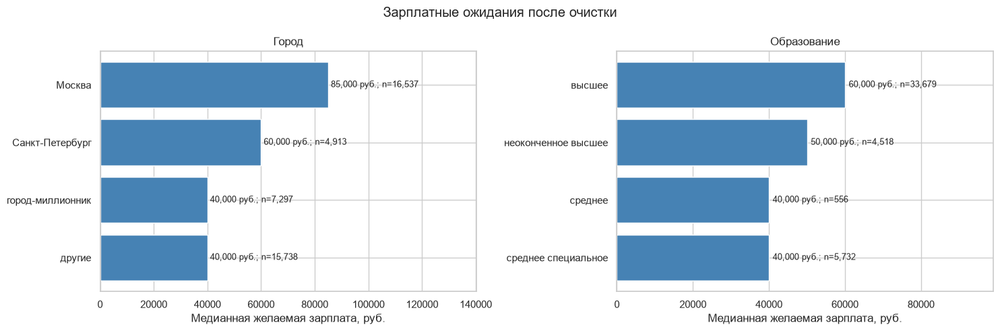

# Анализ резюме HeadHunter

Учебный проект по очистке данных и исследованию зарплатных ожиданий соискателей с помощью Python. Работа основана на учебном ноутбуке с заданиями; в этой версии задания заменены описанием методов и ограничений.

**Статус:** все кодовые ячейки последовательно выполнены на исходной выгрузке 6 ноября 2026 года; графики и итоговые показатели обновлены.

## Основные результаты

Из 44 744 исходных резюме после очистки осталось 44 485. Удалены 161 полный дубликат, 2 строки без места работы или должности, 89 строк вне принятого диапазона зарплат и 7 строк с опытом больше возраста. Три редких значения возраста помечены, но сохранены.

| Группа города | Резюме после очистки | Медианная желаемая зарплата |
|---|---:|---:|
| Москва | 16 537 | 85 000 ₽ |
| Санкт-Петербург | 4 913 | 60 000 ₽ |
| Города-миллионники | 7 297 | 40 000 ₽ |
| Другие города | 15 738 | 40 000 ₽ |

Медиана для соискателей с высшим образованием — 60 000 ₽, с неоконченным высшим — 50 000 ₽, со средним и средним специальным — 40 000 ₽. Различия описывают эту историческую выборку и не доказывают влияние образования или города на доход.



## Задача

Преобразовать текстовые поля резюме в аналитические признаки, привести желаемую зарплату к рублям, проверить качество данных и сравнить зарплатные ожидания по городу, образованию, возрасту и готовности к поездкам.

Исследование касается **желаемой зарплаты**, а не фактических доходов, зарплат в вакансиях или спроса работодателей.

## Инструменты и методы

- Python, Pandas и NumPy: обработка строк, дат, пропусков, дубликатов, объединение таблиц и агрегирование.
- Matplotlib и Seaborn: распределения, столбчатые диаграммы, тепловая карта и диаграмма рассеяния.
- Jupyter: воспроизводимый порядок вычислений и пояснения к анализу.

## Что делает ноутбук

1. Проверяет структуру и заполненность исходных данных.
2. Выделяет образование, пол, возраст, опыт в месяцах, город и признаки мобильности.
3. Представляет варианты занятости и графика отдельными логическими столбцами.
4. Присоединяет валютные курсы по валюте и дате обновления резюме. Проверяет, что объединение не размножило строки, а курсы найдены.
5. Выполняет первичный анализ распределений и сравнений между группами.
6. Удаляет полные дубликаты, обрабатывает пропуски и применяет явно описанные правила очистки.
7. Помечает редкие значения возраста без автоматического удаления и выводит размеры групп и медианы зарплатных ожиданий после очистки.

## Данные

- `data/hh_database.csv` — исходная таблица резюме с разделителем `;`. Файл не входит в репозиторий. Нужна исходная выгрузка, использованная в учебном проекте; проверенная общедоступная ссылка пока не установлена.
- `ExchangeRates.csv` — таблица валютных курсов из исходного репозитория. Используются поля `currency`, `date`, `close`, `proportion`. Согласно тексту исходного задания, выгрузка охватывает 29.12.2017–05.12.2019; происхождение файла следует уточнить до окончательной публикации.

Необходимые столбцы резюме: `Образование и ВУЗ`, `Пол, возраст`, `Опыт работы`, `Город, переезд, командировки`, `Занятость`, `График`, `ЗП`, `Обновление резюме`, `Ищет работу на должность:`, `Последнее/нынешнее место работы`, `Последняя/нынешняя должность`.

## Запуск

Проверено на Python 3.13. Команды выполняются из папки проекта:

```bash
python -m pip install -r requirements.txt
python -m jupyter lab
```

Создайте папку `data`, поместите в неё исходную таблицу под именем `hh_database.csv`. Файл `ExchangeRates.csv` должен находиться рядом с ноутбуком. Откройте `hh_database_project.ipynb` и выполните **Restart Kernel and Run All Cells**.

Если расчёт остановится из-за отсутствующего курса или некорректной даты, сначала проверьте исходные значения. Подменять отсутствующий курс единицей нельзя. Google Drive для запуска не требуется.

## Правила и ограничения

- Зарплата в рублях = исходная сумма × `close` / `proportion`. Для рублей курс и номинал равны 1.
- Ранние графики используют данные до окончательной очистки; некоторые дополнительно ограничены зарплатой ниже 1 млн рублей. Итоговые таблицы в конце используют очищенную выборку.
- Строки без места работы или должности исключаются; пропуски опыта заполняются медианой. Это учебные решения, способные влиять на результаты.
- Для итоговой выборки принят диапазон зарплатных ожиданий от 1 000 до 1 000 000 рублей включительно. Значения вне него не объявляются заведомо ошибочными.
- Опыт, превышающий возраст, считается несогласованным. Сравнение выполняется в месяцах без округления.
- Редкие значения возраста диагностируются на шкале `log(1 + возраст)` с границами −3σ и +4σ. Они сохраняются: редкость не доказывает ошибку.
- Отсутствующая информация о командировках трактуется как неготовность. Названия должностей не нормализованы; близкие формулировки считаются отдельно.
- Различия между группами не доказывают причинность и не характеризуют весь рынок труда. Численность резюме не позволяет оценить спрос работодателей.

## Результаты и проверка

Все кодовые ячейки выполнены последовательно в одном процессе Python; результаты и 12 графиков сохранены в ноутбуке. Проверено сохранение 44 744 строк при объединении с курсами и отсутствие ненайденных курсов. Итоговые числа сохранены в `reports/summary.json`. Изображения проверены визуально. Проверенные версии основных библиотек: Pandas 2.3.3, NumPy 2.5.4, Matplotlib 3.11.2, Seaborn 0.13.2. Интерактивный запуск через интерфейс Jupyter отдельно не проверялся.

## Файлы

| Файл | Содержание |
|---|---|
| `hh_database_project.ipynb` | Подготовка, диагностика, графики и итоговые таблицы |
| `ExchangeRates.csv` | Исходные валютные курсы |
| `requirements.txt` | Версии основных библиотек, использованные при проверке |
| `data/hh_database.csv` | Локальный входной файл, исключённый из Git |
